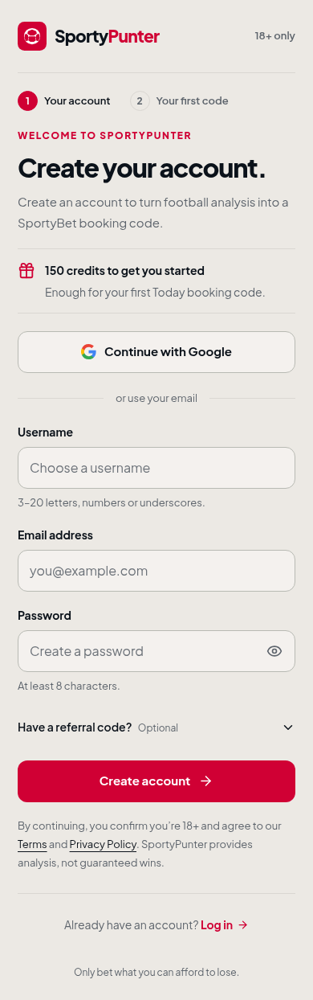
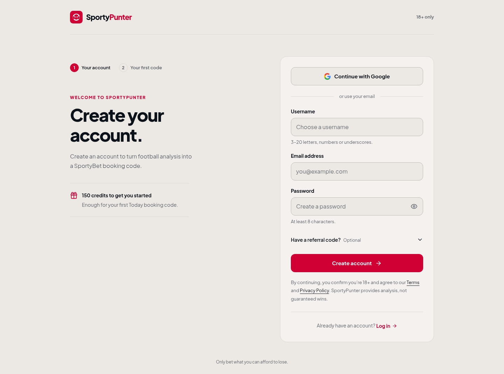

# Welcome flow redesign

The sandbox now runs from signup through a first booking code. The production
reference files in `original-code/` and the exact logo component are unchanged.

## Design

- Warm brand background, original red and slate colors, exact badge and two-tone
  wordmark. Plus Jakarta Sans is bundled locally with Fontsource to avoid an
  external font request or accidental system-font fallback.
- A single-column phone layout; at wider widths, a quiet introduction sits beside
  the form. No gradients, promotional filler, popups, or toast messages.
- Persistent field labels, 16px input text, 52px primary controls, visible focus,
  reduced-motion support, live field feedback, and inline recovery.
- The optional referral input opens only when requested or an invite supplies a
  code. The current value is honored by both email and Google signup.
- First run keeps Today / Play Safe / 2–5 odds ready to go. The cost is explicit:
  150 welcome credits pay for the code, not a betting stake. Deferring is allowed.
- Progress, failed generation, unavailable games, retry, copy confirmation,
  clipboard denial, restored results, and refresh during generation all work.

## Run and verify

```sh
cd demo
npm install
npm run dev
# Open http://localhost:5173/signup

npm run build
npm run typecheck
npx playwright install chromium
npm test
```

For an existing Chromium installation:

```sh
CHROMIUM_PATH=/usr/bin/chromium npm test
```

17 Playwright tests cover the full flow, error recovery, keyboard access,
reduced motion, referral and redirect handling, stale availability responses,
clipboard behavior, and booking restoration. Route layouts are checked at 320,
375, 390, 430, 768, and 1440 pixels. Axe checks cover signup, validation, auth
errors, booking error/result, and password-reset confirmation.

## Demo states

Use any valid email, a username with 3–20 letters/numbers/underscores, and a
password of at least 8 characters. `taken`, `admin`, and `sportypunter` are taken
usernames. `error@example.com` triggers an auth failure.

For deterministic error testing, set a session fixture in the browser console:

```js
sessionStorage.setItem('sp_demo_failure', JSON.stringify('booking'));
```

Supported values: `signup`, `login`, `google`, `username`, `booking`, `empty`,
`reset`. Remove `sp_demo_failure` to recover. Clear `sp_demo_booking` and
`sp_demo_booking_pending` to start another first-code demonstration. The tests
use isolated browser contexts, so fixtures never leak between tests.

Google's `/api/auth/google` URL is handled by a **demo-only** route. It simulates
a redirect and creates no real Google or production session. Sample code
`DEMO150` and sample selections are clearly marked and cannot place a bet.
No passwords are persisted. Booking state and the demo username live in session
storage; the referral code and existing device identifier use local storage.

## Integration boundaries

The auth contracts remain:

- `signup({ username, email, password, referralCode? })`
- `login(identifier, password)`
- `api.checkUsername(username) -> { available }`
- `/api/auth/google?intent=…&next=…&ref=…`, with the existing `sp_device_id` cookie
- Default signup destination `/generate?starter=1`; local return paths preserved.

`demo/src/lib/starter-demo.ts` isolates simulated booking behavior. Its starter
request matches the original fields and values:

```ts
{ puntingType: 'safe', window: 'today', oddsBand: '2-5' }
```

For production adoption, connect the presentation to the existing `plan`,
`reachability`, `useJobRun`, and `api.predictStream` implementation in
`original-code/generate.tsx`. Keep its server validation, charging, confirmation,
job reattachment, analytics, and conversion logic. This sandbox does not invent
or replace those backend contracts. The fixed welcome balance and sample
results belong only to the demo adapter.

Dashboard, password-reset, Google callback, Terms, and Privacy destinations are
explicit demo scaffolds because the repository did not include those production
implementations or legal documents. Preserve the real existing routes when
integrating; do not ship the demo fixtures or legal notices to production.

## Visual review

| Signup on a phone | First booking | Booking result |
| --- | --- | --- |
|  |  |  |


