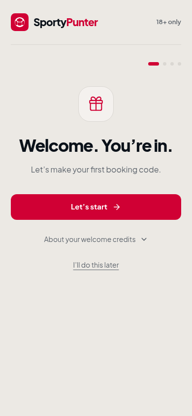
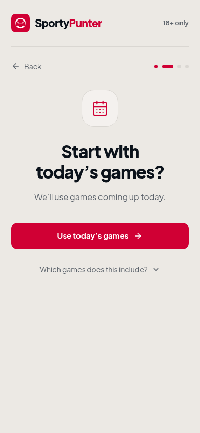
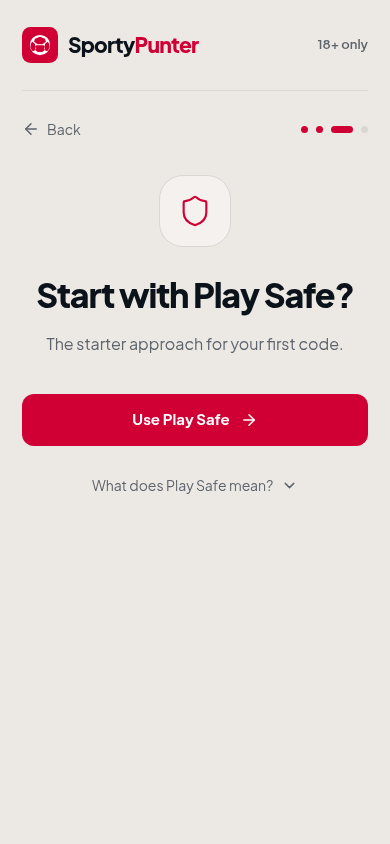
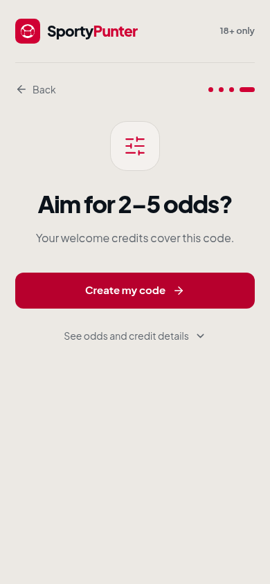
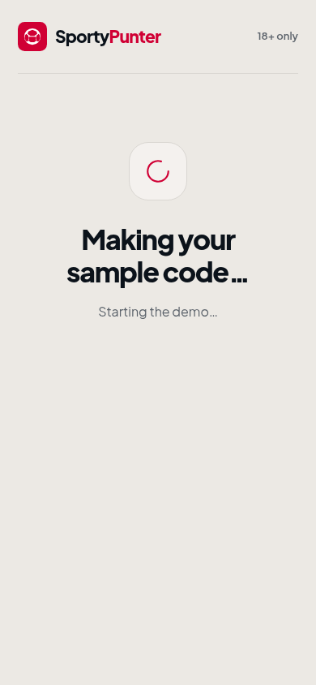
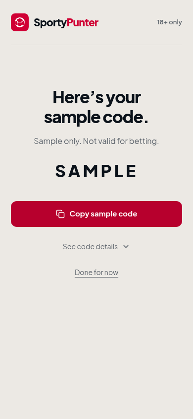
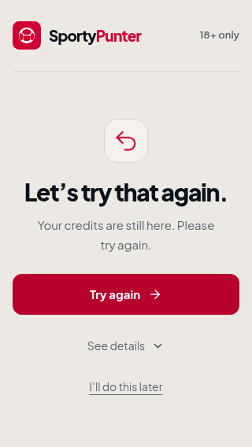
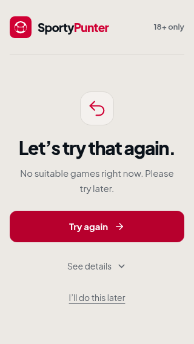

# Welcome flow redesign

The sandbox now runs from signup through a first booking code. The production
reference files in `original-code/` and the exact logo component are unchanged.

## Progressive first run

The first-code page is now a short guided conversation. Each interactive screen
contains one question or action, one primary button, and at most two lines of
supporting copy at phone width. Loading shows only the current status. Details are closed by default and close again when moving
to another question. There is no booking summary or payment table to read first.

| Screen | Primary action | Only shown after tapping the details link |
| --- | --- | --- |
| Welcome | Let’s start | The 150 welcome credits explanation |
| Today | Use today’s games | Which games the Today window includes |
| Play Safe | Use Play Safe | What the name means; no guarantee of a win |
| Odds target | Create my code | What 2–5 odds means and how welcome credits are used |
| Preparing the code | Wait for the result | No additional details; just the current demo stage, without percentages |
| Sample code | Copy sample code | Sample picks, using a real code, and credit bookkeeping |
| Copied | Go to dashboard | The same optional code details |

The path keeps the original Today / Play Safe / 2–5 starter request. Users
confirm these defaults one at a time. There are no additional plan or betting
choices, and no details panel must be opened to finish.

- One meaningful icon per question; the sample code itself is the result visual.
  Generous whitespace, readable text, and a single primary button guide each step.
- Warm brand background, unchanged red and slate tokens, exact logo file and
  two-tone wordmark. Plus Jakarta Sans remains bundled locally.
- Both the in-flow Back control and browser Back restore earlier questions.
  Refresh and a return from the dashboard retain the current question. Starting
  a new demo signup resets the conversation to Welcome.
- A focused error screen replaces the question when generation fails. Retry
  retains the starter request. Refresh during generation resumes the demo job;
  a completed code is restored without another credit deduction.
- Explanations, odds descriptions, credit arithmetic, and code instructions are
  behind explicit, keyboard-operable native disclosures. No popups or toasts.
- Demo results contain no invented odds, probabilities, confidence scores, or
  performance claims. The code is literally `SAMPLE`, and picks are explicitly
  labeled as illustrations. Older saved demo results are sanitized on restore.
- Google sign-in, username/email/password, optional referral, validation, 18+,
  terms links, and the signup/login visual design remain in place.

## Run and verify

```sh
cd demo
npm install
npm run dev
# Open http://localhost:5173/signup

npm run build
npm run typecheck
npx playwright install chromium
npm test
```

For an existing Chromium installation:

```sh
CHROMIUM_PATH=/usr/bin/chromium npm test
```

25 Playwright tests cover the full flow and its recovery states. Route layouts
are checked at 320, 375, 390, 430, 768, and 1440 pixels. Each guided question is
also checked at 320×568, 390×844, and 430×932 for a single primary action, a
visible button, hidden details, readable two-line supporting copy, and no
horizontal overflow. Generation failure and unavailable-game recovery are
checked at 320×568.

Checks also cover in-flow Back, browser Back, refreshed questions, defer/resume,
refresh during generation, restored results, stale username responses, Google
return/referral parameters, keyboard disclosures, focus, reduced motion, and
clipboard success/failure. Axe checks include each question, auth validation and
errors, booking errors/results, and password-reset confirmation.

Recreate the committed screenshots while the demo server is running:

```sh
cd demo
CHROMIUM_PATH=/usr/bin/chromium node scripts/capture-onboarding.mjs
```

## Demo states

Use any valid email, a username with 3–20 letters/numbers/underscores, and a
password of at least 8 characters. `taken`, `admin`, and `sportypunter` are taken
usernames. `error@example.com` triggers an auth failure.

For deterministic error testing, set a session fixture in the browser console:

```js
sessionStorage.setItem('sp_demo_failure', JSON.stringify('booking'));
```

Supported values: `signup`, `login`, `google`, `username`, `booking`, `empty`,
`reset`. Remove `sp_demo_failure` to recover. Clear `sp_demo_booking`,
`sp_demo_booking_pending`, and `sp_demo_starter_step`, then open `/generate`
to start another first-code demonstration. The tests use isolated browser
contexts, so fixtures never leak between tests.

Google's `/api/auth/google` URL is handled by a **demo-only** route. It simulates
a redirect and creates no real Google or production session. Sample code
`SAMPLE` and sample selections are clearly marked and cannot place a bet.
No passwords are persisted. Booking state and the demo username live in session
storage; the referral code and existing device identifier use local storage.

## Integration boundaries

The auth contracts remain:

- `signup({ username, email, password, referralCode? })`
- `login(identifier, password)`
- `api.checkUsername(username) -> { available }`
- `/api/auth/google?intent=…&next=…&ref=…`, with the existing `sp_device_id` cookie
- Default signup destination `/generate?starter=1`; local return paths preserved.

`demo/src/lib/starter-demo.ts` isolates simulated booking behavior. Its starter
request matches the original fields and values:

```ts
{ puntingType: 'safe', window: 'today', oddsBand: '2-5' }
```

For production adoption, connect the presentation to the existing `plan`,
`reachability`, `useJobRun`, and `api.predictStream` implementation in
`original-code/generate.tsx`. Keep its server validation, charging, confirmation,
job reattachment, analytics, and conversion logic. This sandbox does not invent
or replace those backend contracts. The fixed welcome balance and sample
results belong only to the demo adapter.

Dashboard, password-reset, Google callback, Terms, and Privacy destinations are
explicit demo scaffolds because the repository did not include those production
implementations or legal documents. Preserve the real existing routes when
integrating; do not ship the demo fixtures or legal notices to production.

## Visual review

Default phone screens, with every disclosure closed:

| Welcome | Today |
| --- | --- |
|  |  |

| Play Safe | Odds target |
| --- | --- |
|  |  |

| Preparing the sample | Sample result |
| --- | --- |
|  |  |

| Retry at 320px | Unavailable games at 320px |
| --- | --- |
|  |  |

Additional reviewed states:

- [Odds and credit details, explicitly opened](docs/screenshots/onboarding-details.png)
- [Sample code details, explicitly opened](docs/screenshots/booking-details.png)
- [Copy confirmation and next action](docs/screenshots/booking-copied.png)
- [Desktop welcome](docs/screenshots/onboarding-desktop.png)
- [Preserved phone signup](docs/screenshots/signup-mobile.png)
- [Preserved desktop signup](docs/screenshots/signup-desktop.png)
